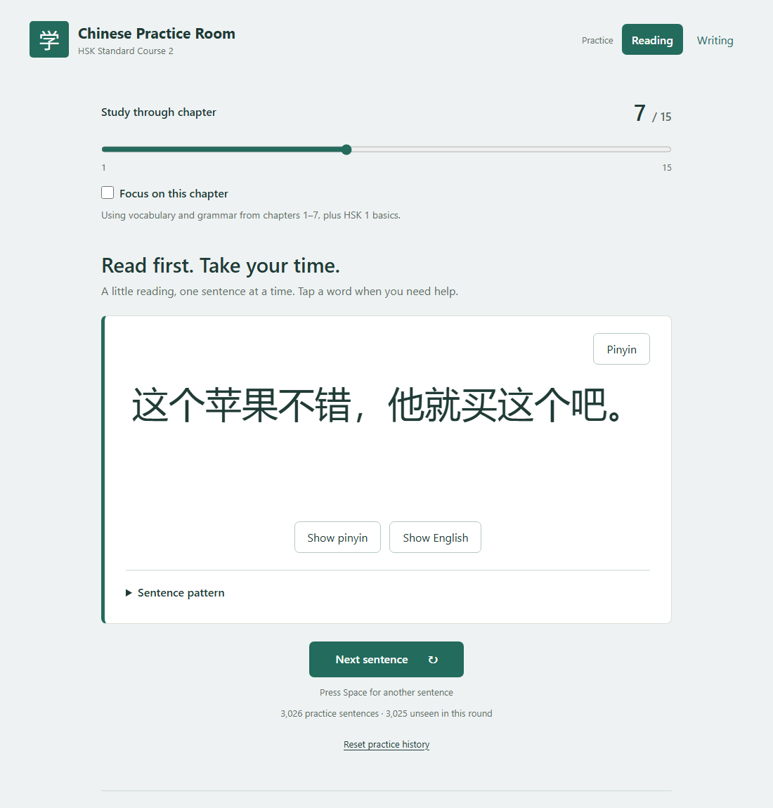

# Chinese Practice Room

A static app for practicing Mandarin reading and character writing, with HSK 1 foundations and HSK 2 chapters 1–15.

Download and extract the [offline app](dist/reading-room-offline.zip?raw=true), then open `index.html` in your browser. You can also serve the site locally with Python 3.

```sh
python -m http.server 8000 --directory dist
```

Visit `http://localhost:8000` to practice. Reading includes sentence hints, word lookup, and stroke order. Writing uses flashcards with stroke-order playback and self-rated review. Progress is stored in the browser.

The [chapter notes ZIP](dist/chapters.zip?raw=true) contains Markdown notes for all 15 chapters. The [grammar guide](dist/GRAMMAR_PATTERNS.md) covers the sentence patterns used in reading practice.

## Screenshots

### Reading



### Writing


## Stroke-order assets

The GIF and PNG files in `dist/strokes/` were rendered from Hanzi Writer Data 2.0.1 glyph outlines. The script rasterizes the outlines onto a practice grid and adds colored stroke-order frames. The source and license are listed in `dist/strokes/LICENSE.txt`.

To regenerate these assets, install Pillow and fonttools and pass the upstream `hanzi-writer-data-2.0.1.tgz` archive to `python generate_strokes.py`.

## Build and verify

The content sources are in `chapters/`, `foundation.json`, and `grammar_catalog.json`. Run `python build.py` to regenerate the reading and writing datasets and both ZIP downloads. Run `python verify.py` and `node verify-app.cjs` to check the build.
