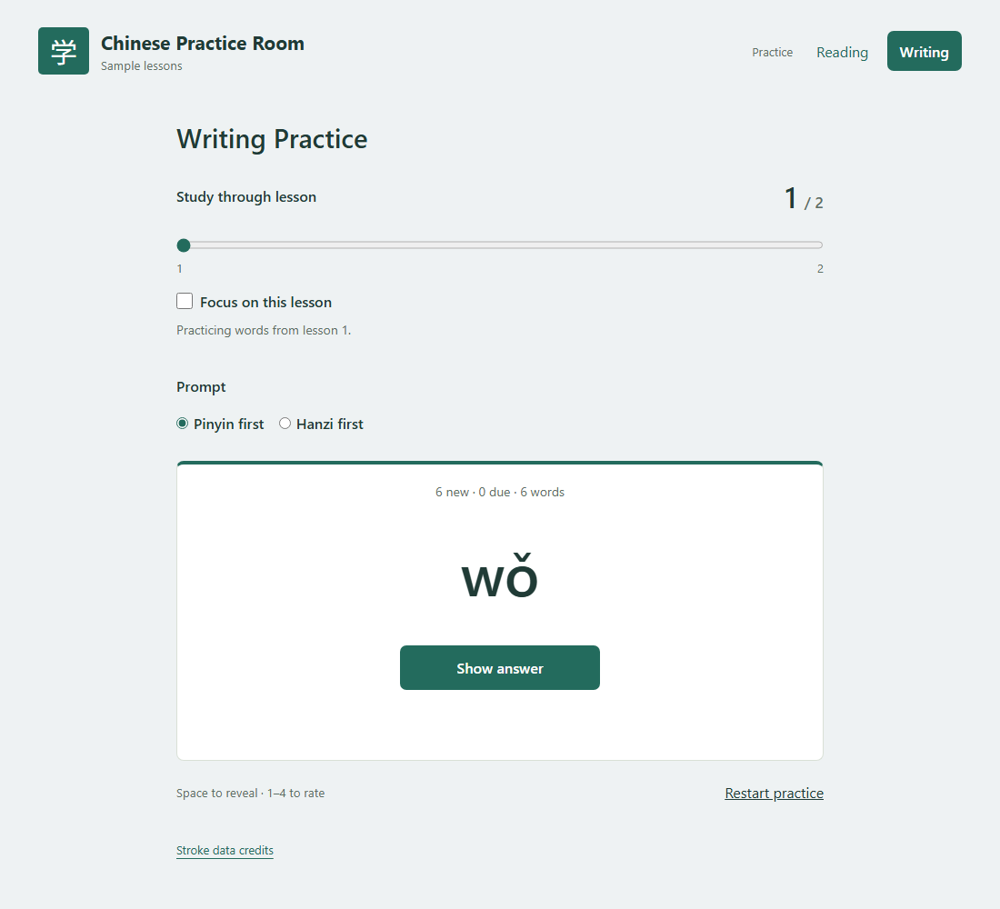

# Chinese Practice Room

A static app for practicing Mandarin reading and character writing. This public edition includes two original sample lessons.

Open `dist/index.html` directly in a browser, or serve the app locally with Python 3.

```sh
python -m http.server 8000 --directory dist
```

Visit `http://localhost:8000` to practice. Reading includes sentence hints, word lookup, and stroke order. Writing uses flashcards with stroke-order playback and self-rated review. Progress is stored in the browser.

The reading and writing datasets are in `dist/data.js` and `dist/writing-data.js`. Downloadable lesson notes are in `dist/chapters/`. There is no build step for the files in this repository.

## Screenshots

### Reading


### Writing



## Stroke-order assets

The GIF and PNG files in `dist/strokes/` were rendered from Hanzi Writer Data 2.0.1 glyph outlines for this edition. The script rasterizes the outlines onto a practice grid and adds colored stroke-order frames. The source and license are listed in `dist/strokes/LICENSE.txt`.

To regenerate these assets, install Pillow and fonttools and pass the upstream `hanzi-writer-data-2.0.1.tgz` archive to `python generate_strokes.py`.
